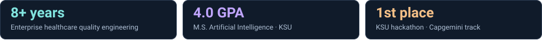
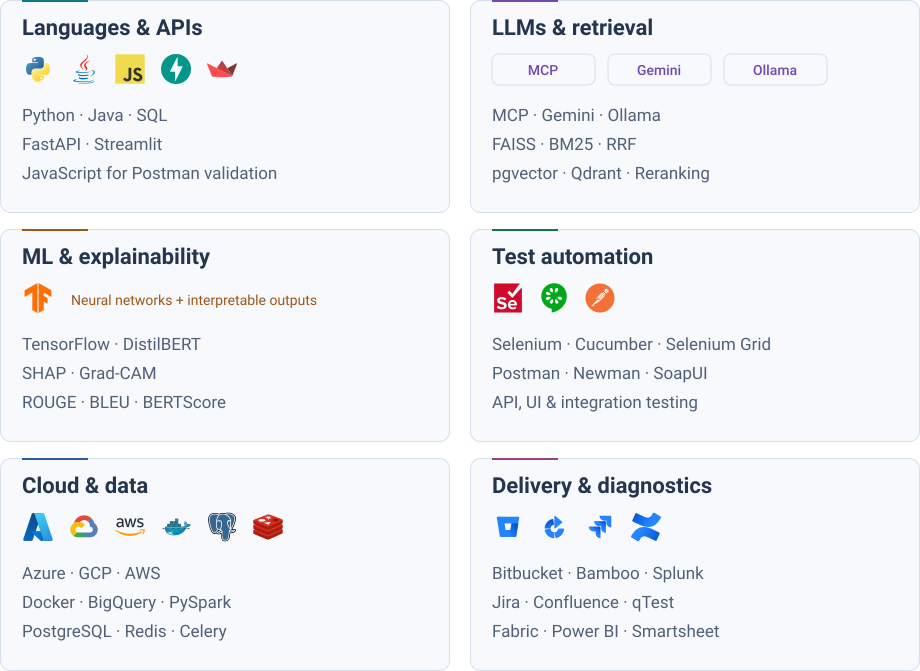

<picture>
  <source media="(max-width: 640px)" srcset="./assets/hero-compact.svg">
  
</picture>

<b>I build AI systems you can trace, test, and explain.</b>

  <a href="#about">About</a> ·
  <a href="#skills--tools">Skills &amp; tools</a> ·
  <a href="#featured-projects">Projects</a> ·
  <a href="#experience">Experience</a> ·
  <a href="#education--recognition">Recognition</a> ·
  <a href="#connect">Connect</a>

<picture>
  <source media="(max-width: 640px)" srcset="./assets/credentials-compact.svg">
  
</picture>

## About

I'm an AI practitioner with an M.S. in Artificial Intelligence from Kennesaw State University and a background in enterprise healthcare quality engineering at **Carelon** and **Accenture**.

My work connects **AI development, evaluation, and software quality**. I've validated enterprise Voice AI, built retrieval systems that expose their sources, and researched how neural networks can be represented as logic.

- **Building** · RAG applications, tools for AI agents, and evidence-based release analysis.
- **Exploring** · Agent orchestration with LangGraph, adaptive GraphRAG, and practical LLM evaluation.
- **Interested in** · Explainable AI, NLP, computer vision, and responsible AI design.

## Skills & tools

<picture>
  <source media="(max-width: 640px) and (prefers-color-scheme: dark)" srcset="./assets/toolkit-dark-compact.svg">
  <source media="(max-width: 640px)" srcset="./assets/toolkit-light-compact.svg">
  <source media="(prefers-color-scheme: dark)" srcset="./assets/toolkit-dark.svg">
  
</picture>

<b>Skills in practice</b>

- **Languages and APIs** · Python in AI and academic projects. Java for automation. SQL for data work. JavaScript for Postman validation scripts. FastAPI and Streamlit for AI applications.
- **LLMs and retrieval** · MCP, Gemini, Ollama, FAISS, BM25, Reciprocal Rank Fusion, pgvector, Qdrant, and cross-encoder reranking. Current exploration includes LangChain and LangGraph orchestration.
- **ML and explainability** · TensorFlow, DistilBERT, neural networks, NLP, computer vision, SHAP, and Grad-CAM. Evaluation work includes ROUGE, BLEU, BERTScore, precision-recall analysis, and error analysis.
- **Test automation** · Selenium, Cucumber, Selenium Grid, Postman, Newman, and SoapUI. Functional, regression, API, UI, integration, and UAT testing. Voice AI and chatbot validation.
- **Cloud and data** · Azure AI Search, Azure Container Apps, Google Cloud Run, BigQuery, Apache Spark/PySpark, Docker, PostgreSQL, Redis, and Celery. AWS experience includes validating cloud migrations.
- **Delivery and diagnostics** · Bitbucket, Bamboo, Splunk, Jira, Confluence, qTest, Microsoft Fabric, Power BI, and Smartsheet.

## Featured projects

<table>
<tr>
<td width="50%" valign="top">
<h3><a href="https://github.com/sukumarmuthusamy/policypulse-xai">PolicyPulse</a></h3>

<b>Policy answers with visible evidence</b> Independent project · deployed demo

Ask questions about company policy PDFs, then inspect the source passages, retrieval scores, and tool calls behind each answer.

<code>FastAPI</code> <code>Streamlit</code> <code>FAISS + BM25</code> <code>Cloud Run</code>

<a href="https://github.com/sukumarmuthusamy/policypulse-xai">Explore the project →</a>
</td>
<td width="50%" valign="top">
<h3><a href="https://github.com/sukumarmuthusamy/nn2logic">NN2Logic</a></h3>

<b>From neural networks to logic</b> Team capstone research · KSU

Translate neural models through arithmetic circuits and logical representations to study their decisions, traceability, and robustness.

<code>TensorFlow</code> <code>Neuro-symbolic AI</code> <code>SDD</code>

<a href="https://github.com/sukumarmuthusamy/nn2logic/blob/main/notebooks/nn2logic_scaled_multilayer_pipeline.ipynb">Open the research notebook →</a>
</td>
</tr>
<tr>
<td width="50%" valign="top">
<h3><a href="https://github.com/sukumarmuthusamy/sentinelflow">SentinelFlow</a></h3>

<b>Release risk and regression planning</b> Independent project · in progress

Analyze a software change, trace affected dependencies, and collect evidence for a regression plan. A deterministic engine computes release risk.

<code>Python</code> <code>MCP</code> <code>Hybrid retrieval</code> <code>pgvector</code>

<a href="https://github.com/sukumarmuthusamy/sentinelflow/blob/master/docs/ENGINEERING_JOURNAL.md">Read the engineering journal →</a>
</td>
<td width="50%" valign="top">
<h3><a href="https://github.com/sukumarmuthusamy/docmind-xai">DocMind</a></h3>

<b>Document Q&amp;A with local models</b> Independent project

Run document retrieval with Ollama, background ingestion, streaming responses, and citations. Explore the limitations of smaller models used as evaluators.

<code>Ollama</code> <code>FastAPI</code> <code>Celery</code> <code>Redis</code>

<a href="https://github.com/sukumarmuthusamy/docmind-xai">Explore the project →</a>
</td>
</tr>
</table>

<b>More academic work in NLP, vision, ML, and data engineering</b>

| Project | What I worked on |
| --- | --- |
| Actionable Review Intelligence | Fine-tuned DistilBERT to identify actionable review feedback, with 1,000 manually annotated reviews and error analysis. |
| Wildlife Image Classification | Studied cross-location domain shift using ResNet-50, CORAL, Batch Normalization adaptation, and Grad-CAM. |
| Credit Card Fraud Detection | Built a SMOTE-augmented neural baseline and evaluated a team deep-clustering system on 284,807 transactions. |
| Cyber Threat Detection | Used PySpark, Random Forest, XGBoost, and anomaly detection on NSL-KDD network traffic. |
| Explainable Claim Classification | Combined Random Forest, imbalance handling, and SHAP explanations in an interactive desktop application. |
| Job Market Data Warehouse | Built a BigQuery star schema, Python ETL, OLAP queries, and Looker Studio dashboards. |
| Privacy in Predictive Healthcare AI | Researched patient autonomy, federated learning, differential privacy, and responsible AI design. |

## Experience

**Kennesaw State University** · Graduate Professional Assistant 
Office of Accreditation &amp; Policy · Aug 2025 to May 2026

Built an Azure-based RAG chatbot proof of concept and an automated evaluation pipeline using Microsoft Fabric and Azure AI Search. Automated data intake and reporting across **11 colleges and 300+ programs**, reducing manual processing time by **40%**.

**Carelon Global Solutions** · Tech Lead QA 
Client · Elevance Health · Apr 2024 to Dec 2024

Led validation of a **550+ API migration to AWS**, using Splunk and Postman to trace impacts and verify responses. Coordinated regression strategy and expanded Java, Selenium, and Cucumber automation.

**Carelon Global Solutions** · Senior QA Engineer 
Client · Elevance Health · Sep 2020 to Mar 2024

Led QA for Pega Voice AI through a phased rollout to **10,000+ users**, validating speech-to-text, entity extraction, and co-pilot features. Led an **8-member regression QA team**, supported **30+ QA engineers**, and maintained automation through Bitbucket and Bamboo.

**Accenture** · Associate Software Engineer to Test Engineering Senior Analyst 
Client · Elevance Health, formerly Anthem · Aug 2016 to Sep 2020

Worked on automation, API testing, and end-to-end voice and desktop workflows for healthcare applications. Mentored and onboarded **40+ engineers** and coordinated quality activities with offshore and US teams.

## Education & recognition

- **M.S. in Artificial Intelligence** · Kennesaw State University, 2026. **4.0 GPA** and Dean's 4.0 Club across all four semesters.
- **2026 Outstanding Student Award** · M.S. in Artificial Intelligence, KSU College of Computing and Software Engineering.
- **1st place, Capgemini track** · KSU Hackathon for Social Good, Spring 2026. Co-designed and presented **MycoMind**, an AI-driven reforestation concept, in a 48-hour ideation event.
- **B.E. in Mechanical Engineering** · College of Engineering Guindy, Anna University, 2016.

<b>Professional recognition</b>

- Carelon **2023 Star of Stars** and **Exemplar Award**.
- **12 IMPACT recognitions** for quality contributions, 2022 to 2024.
- Individually recognized by leadership as a key contributor to the Voice AI work behind **Elevance Health's 2023 PEGA Innovation Award**.
- Accenture **H&amp;PS Zenith Young Champion Award**, 2018.

### Certifications

**Microsoft Certified · Azure AI Apps and Agents Developer Associate** 
Jul 2026 to Jul 2027

<b>Additional certifications and training</b>

- Google Cloud · Perform Foundational Data, ML, and AI Tasks, 2021.
- Accenture · Agile Professional Certified, 2018.
- Tricentis · Automation Specialist Level 1, Tosca, 2017. Certification and training.
- CITI Program · AI and Human Subject Protections, Biomedical Research, and Social, Behavioral &amp; Educational Research with Human Subjects, 2025 to 2028.
- AWS Certified Developer Associate · Formerly certified, 2020 to 2023.

## Contribution snake

<picture>
  <source media="(prefers-reduced-motion: reduce) and (prefers-color-scheme: dark)" srcset="./assets/github-calendar-dark.svg">
  <source media="(prefers-reduced-motion: reduce)" srcset="./assets/github-calendar-light.svg">
  <source media="(prefers-color-scheme: dark)" srcset="./assets/github-snake-dark.svg">
  
</picture>

My GitHub contributions, with a little motion. Generated with <a href="https://github.com/Platane/snk">Platane/snk</a>.

## Connect

[LinkedIn](https://www.linkedin.com/in/sukumarmuthusamy/) · [Email](mailto:sukumarm1994@gmail.com) · [Browse my repositories](https://github.com/sukumarmuthusamy?tab=repositories)

Outside the projects · anime, curiosity, and figuring out how things work.
